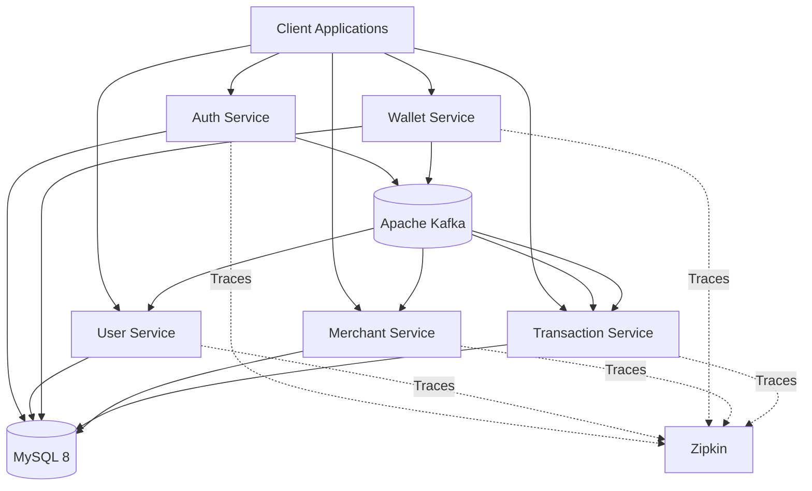

# MicroBank

### A Microservices-Based Banking System

MicroBank is a backend banking application built with **Java 21 and Spring Boot**, following a microservices architecture. It provides a modular foundation for managing users, authentication, digital wallets, merchants, and financial transactions.

The system combines synchronous REST APIs with asynchronous event-driven communication, JWT-based authentication, and distributed tracing to improve service isolation, maintainability, and observability.

## Architecture

MicroBank is composed of five main microservices:

| Service | Port | Responsibility |
|---|---:|---|
| Auth Service | `8080` | User registration, authentication, and JWT generation. |
| User Service | `8081` | User profile management and role-based access. |
| Merchant Service | `8082` | Merchant registration, management, and transaction processing. |
| Wallet Service | `8083` | Wallet management, balance operations, recharges, and payments. |
| Transaction Service | `8085` | Transaction records, event consumption, and auditing of financial operations. |

### Architecture Overview



## Key Features

### Authentication & Security
- User registration and login.
- JWT-based authentication.
- Password hashing.
- Role-based authorization using Spring Security.
- Separate access permissions for `USER` and `ADMIN` roles.
- Protected REST endpoints.

### User Management
- User profile retrieval and management.
- User search by username or role.
- Paginated and sortable results.
- Administrative user updates and deletion.

### Digital Wallets
- Wallet creation and management.
- Balance inquiries.
- Balance recharges.
- Payment processing.
- Wallet transaction history.
- Paginated transaction queries.

### Merchant Management
- Merchant registration and administration.
- Merchant status management.
- Merchant search and filtering.
- Merchant transaction processing.

### Transaction Management
- Centralized transaction records.
- Event-driven transaction persistence.
- Transaction search and retrieval.
- Trace ID association for distributed request tracking.
- Administrative transaction queries.

### Event-Driven Communication
Apache Kafka enables asynchronous communication between services.

The current implementation includes:
- `user-created-topic`: Publishes user registration events.
- `wallet.transactions`: Publishes wallet transaction events.

This approach reduces direct dependencies between services and enables independent event processing.

### Distributed Tracing & Observability
MicroBank integrates Micrometer Tracing and Zipkin to provide distributed tracing across services.

- Trace ID and Span ID propagation.
- Request correlation across services.
- Kafka message observation.
- Centralized trace visualization.
- Health monitoring through Spring Boot Actuator.

Zipkin dashboard:

`http://localhost:9411`

## Technology Stack

| Category | Technologies |
|---|---|
| Language | Java 21 |
| Backend Framework | Spring Boot 3.5.4 |
| Security | Spring Security, JWT (JJWT) |
| Database | MySQL 8 |
| Persistence | Spring Data JPA, Hibernate |
| Messaging | Apache Kafka 3.8 |
| Observability | Micrometer, Brave, Zipkin |
| API Documentation | SpringDoc OpenAPI / Swagger |
| Containerization | Docker, Docker Compose |
| Build Tool | Maven |
| Utilities | Lombok, Jackson |

## Project Structure

```text
MicroBank/
│
├── auth-service/
│   ├── src/
│   ├── pom.xml
│   └── Dockerfile
│
├── user-service/
│   ├── src/
│   ├── pom.xml
│   └── Dockerfile
│
├── wallet-service/
│   ├── src/
│   ├── pom.xml
│   └── Dockerfile
│
├── merchant-service/
│   ├── src/
│   ├── pom.xml
│   └── Dockerfile
│
├── transaction-service/
│   ├── src/
│   ├── pom.xml
│   └── Dockerfile
│
├── audit-service/
│   ├── src/
│   └── pom.xml
│
├── mysql/
│   └── init.sql
│
├── docker-compose.yml
└── README.md
```

## Getting Started

### Prerequisites

Make sure you have the following installed:

- Java 21 or later.
- Docker Desktop or Docker Engine.
- Docker Compose.
- Git.

### 1. Clone the repository

```bash
git clone https://github.com/YuukoI/MicroBank.git

cd MicroBank
```

### 2. Configure environment variables

Create a `.env` file in the project root:

```env
JWT_SECRET_KEY=your_secure_secret_key
```

Use a strong secret key for JWT signing.

### 3. Build the microservices

Each service is an independent Maven project.

On Linux/macOS:

```bash
for service in auth-service user-service wallet-service merchant-service transaction-service
do
    (cd "$service" && ./mvnw clean package -DskipTests)
done
```

On Windows PowerShell:

```powershell
$services = @(
    "auth-service",
    "user-service",
    "wallet-service",
    "merchant-service",
    "transaction-service"
)

foreach ($service in $services) {
    Push-Location $service
    .\mvnw.cmd clean package -DskipTests
    Pop-Location
}
```

### 4. Start the infrastructure and services

From the project root:

```bash
docker compose up --build -d
```

This will start MySQL, Kafka, Zipkin, and the five main application services.

### 5. Check running containers

```bash
docker compose ps
```

To inspect application logs:

```bash
docker compose logs -f
```

To stop the environment:

```bash
docker compose down
```

To remove persistent database and Kafka data:

```bash
docker compose down -v
```

**Note:** Removing volumes permanently deletes the persisted local data.

## API Reference

The REST API endpoints are organized by microservice.

| Service | Base Endpoint |
|---|---|
| Authentication | `/microbank/auth` |
| Users | `/microbank/users` |
| Wallets | `/microbank/wallets` |
| Merchants | `/microbank/merchant` |
| Transactions | `/microbank/transactions` |

### Authentication

| Method | Endpoint | Description |
|---|---|---|
| POST | `/microbank/auth/register` | Register a new user. |
| POST | `/microbank/auth/login` | Authenticate and obtain a JWT. |

### Users

| Method | Endpoint | Description |
|---|---|---|
| GET | `/microbank/users` | Retrieve paginated users. |
| GET | `/microbank/users/search` | Search users. |
| GET | `/microbank/users/{id}` | Retrieve a user. |
| PUT | `/microbank/users/{id}` | Update a user (Admin). |
| DELETE | `/microbank/users/{id}` | Delete a user (Admin). |

### Wallets

| Method | Endpoint | Description |
|---|---|---|
| GET | `/microbank/wallets` | Retrieve wallets. |
| GET | `/microbank/wallets/{id}` | Retrieve a wallet. |
| POST | `/microbank/wallets` | Create a wallet (Admin). |
| PUT | `/microbank/wallets/{id}` | Update a wallet (Admin). |
| POST | `/microbank/wallets/{walletId}/recharge` | Recharge a wallet. |
| POST | `/microbank/wallets/{walletId}/payment` | Process a payment. |
| GET | `/microbank/wallets/{walletId}/transactions` | Retrieve wallet transactions. |

### Merchants

| Method | Endpoint | Description |
|---|---|---|
| GET | `/microbank/merchant` | Retrieve merchants. |
| GET | `/microbank/merchant/search` | Search merchants. |
| GET | `/microbank/merchant/{id}` | Retrieve a merchant. |
| POST | `/microbank/merchant` | Register a merchant (Admin). |
| PUT | `/microbank/merchant/{id}` | Update a merchant (Admin). |
| DELETE | `/microbank/merchant/{id}` | Delete a merchant (Admin). |

### Transactions

| Method | Endpoint | Description |
|---|---|---|
| GET | `/microbank/transactions/all` | Retrieve all transactions (Admin). |
| GET | `/microbank/transactions/{transactionId}` | Retrieve a transaction (Admin). |
| GET | `/microbank/transactions/search` | Search transactions (Admin). |

## Monitoring

Once the application is running, you can access the following services:

| Component | URL |
|---|---|
| Auth Service | `http://localhost:8080` |
| User Service | `http://localhost:8081` |
| Merchant Service | `http://localhost:8082` |
| Wallet Service | `http://localhost:8083` |
| Transaction Service | `http://localhost:8085` |
| Zipkin Dashboard | `http://localhost:9411` |
| MySQL | `localhost:3307` |
| Kafka | `localhost:9092` |

Swagger UI is available on the services configured with SpringDoc at:

```text
http://localhost:{port}/swagger-ui/index.html
```

## Development Notes

- Each microservice has its own Maven configuration and database.
- Services use Docker containers for local orchestration.
- Authentication is handled through signed JWT tokens.
- Kafka handles asynchronous event communication.
- Distributed tracing helps monitor requests across service boundaries.
- The current Docker Compose configuration runs the five primary services; the `audit-service` module is present separately and is not included in that orchestration.

## License

This project is intended for educational and portfolio purposes.

